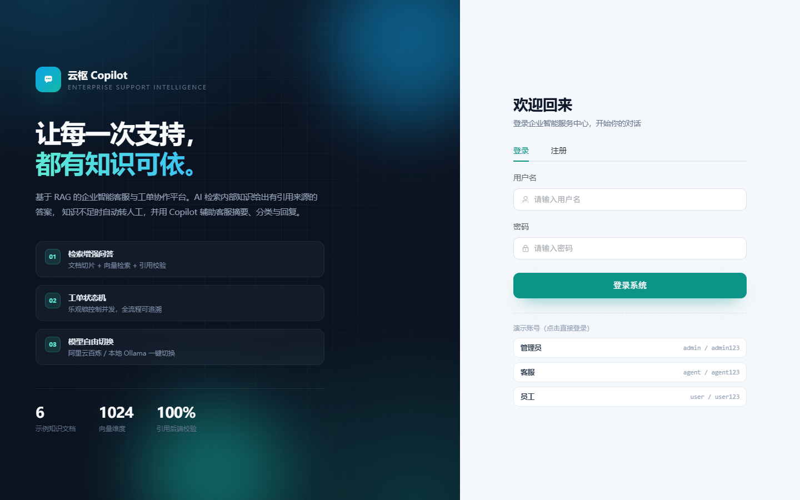
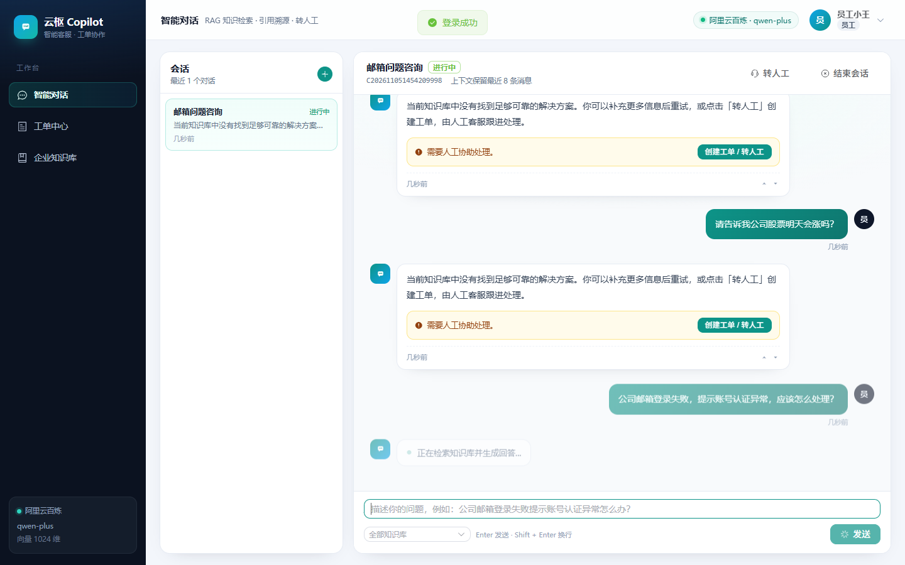
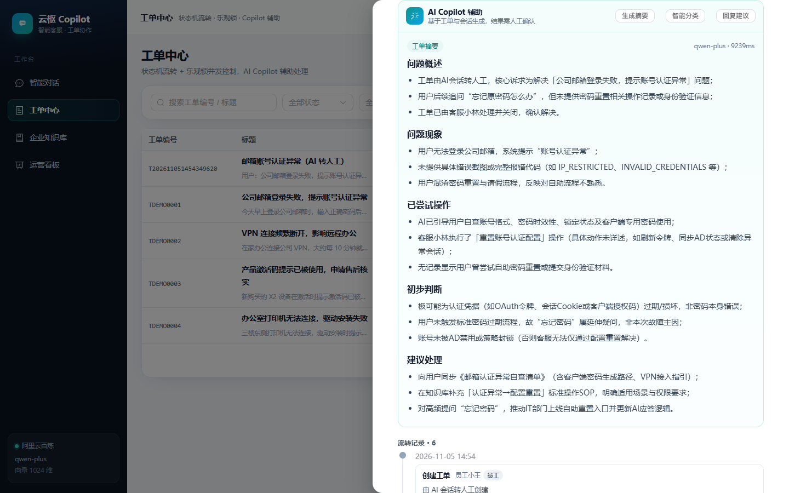
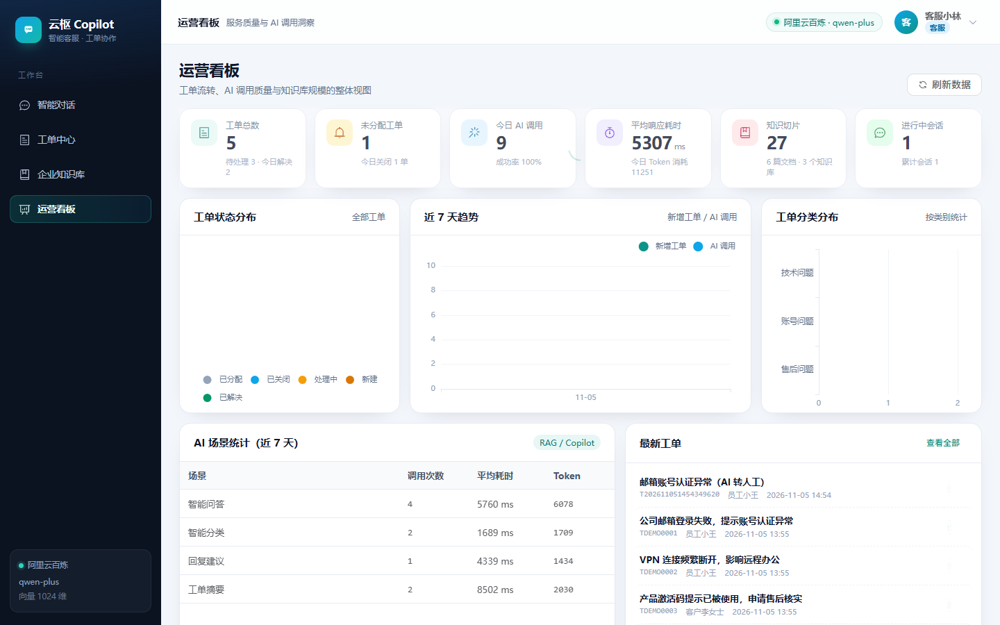
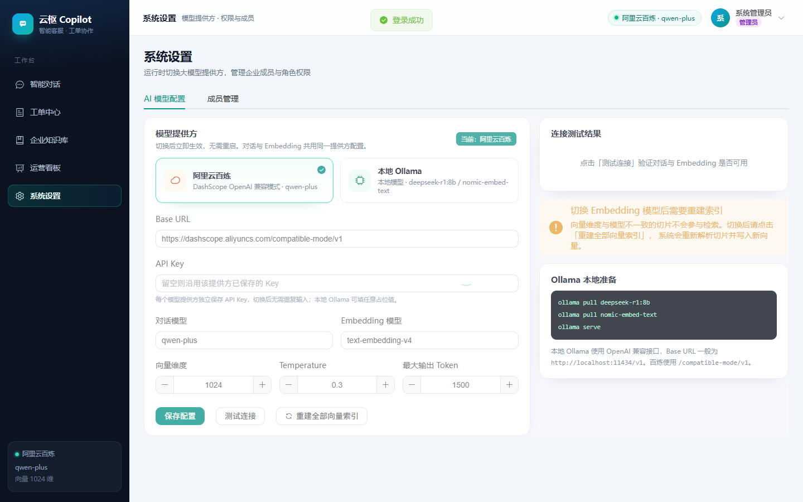

# 云枢 Copilot — 企业智能客服与工单协作平台

面向企业 IT 支持、售后客服与产品技术支持场景的完整演示项目。系统以 **Java 17 + Spring Boot 3 + MySQL + Spring AI + Vue 3** 构建，提供企业知识库 RAG 问答、来源引用、人工转单、工单状态机与 Copilot 辅助处理。

## 功能概览

- 用户与权限：JWT 登录、注册，USER / AGENT / ADMIN 角色；用户只能访问自己的会话与工单，知识库可见范围在后端检索时执行过滤。
- 会话中心：会话列表、历史消息、上下文窗口、结束会话、AI 反馈。
- 企业知识库：PDF、DOC、DOCX、TXT、MD 上传；文档异步解析、页码保留、文本切片、Embedding、MySQL 向量存储、余弦相似度 Top-K 检索、切片预览与重处理。
- AI 智能问答：RAG Prompt、历史对话、引用来源、知识不足转人工、AI 调用日志；运行时可切换百炼或 Ollama。
- 工单管理：创建/分配/接单/处理中/等待用户/解决/关闭/重开；状态机、乐观锁、权限校验、工单事件审计。
- AI Copilot：生成工单摘要、推荐分类与优先级、基于知识库生成回复草稿；回复必须人工确认。
- 运营看板：工单状态/分类、近 7 日趋势、AI 场景统计、平均耗时、Token 用量、知识库指标。
- 系统设置：AI 提供方、模型、向量维度、连接测试、重建索引；管理员用户与角色管理。

## 技术架构

- 后端：Java 17、Spring Boot 3.4、Spring MVC、Spring Security、JWT、MyBatis-Plus、Spring AI OpenAI-compatible API。
- 数据：MySQL 8 同时保存业务数据、文档切片和序列化向量；第一版不强制要求 PostgreSQL / pgvector。
- 文档解析：Apache PDFBox、Apache POI；本地文件存储位于 `data/uploads/`。
- 前端：Vue 3、Vite、Element Plus、Pinia、ECharts、Marked + DOMPurify。
- AI 模型：阿里云百炼 DashScope OpenAI 兼容 API 或本机 Ollama OpenAI 兼容 API。

Embedding 向量以 `MEDIUMBLOB` 序列化保存在 `kb_chunk` 中，按知识库权限、文档完成状态、Embedding 模型和维度过滤后进行余弦相似度检索。适合演示、小规模知识库；数据规模增大后应换用 pgvector / Qdrant / Milvus 并保留 MySQL 业务元数据。

## 环境要求

- Java 17 或更高版本。
- Maven 3.8+。
- MySQL 8；本项目已在 MySQL 8.0.16 上验证。
- Node.js 20+、npm。
- 使用百炼时需要 DashScope API Key；使用 Ollama 时需要 Ollama 服务及聊天、Embedding 模型。

## 快速启动

### 1. 配置 MySQL

默认连接 `127.0.0.1:3306`，账号 `root`，密码 `这是我的秘密`。应用会自动创建 `customer_copilot` 数据库并初始化表结构。可通过环境变量覆盖：

```powershell
$env:MYSQL_HOST = '127.0.0.1'
$env:MYSQL_PORT = '3306'
$env:MYSQL_DATABASE = 'customer_copilot'
$env:MYSQL_USERNAME = 'root'
$env:MYSQL_PASSWORD = '你的数据库密码'
```

`application.yml` 当前包含本机演示配置。部署到其他环境时请使用环境变量覆盖，勿将真实密码提交到代码仓库。

### 2. 配置百炼（默认）

配置文件默认使用百炼 `qwen-plus` + `text-embedding-v4`（1024 维）。推荐用环境变量提供 API Key：

```powershell
$env:DASHSCOPE_API_KEY = '你的百炼 API Key'
```

管理员也可在「系统设置 → AI 模型配置」运行时切换或修改模型。

### 3. （可选）准备本地 Ollama

```powershell
ollama pull deepseek-r1:8b
ollama pull nomic-embed-text
ollama serve
```

管理员在系统设置中选择「本地 Ollama」后，默认配置为：

- Base URL：`http://localhost:11434/v1`
- Chat：`deepseek-r1:8b`
- Embedding：`nomic-embed-text`（768 维）

### 4. 启动后端

Windows PowerShell：

```powershell
$env:JAVA_HOME = 'C:\Program Files\Java\jdk-17'
$env:Path = "$env:JAVA_HOME\bin;$env:Path"
.\scripts\dev.ps1
```

或手动运行：

```powershell
mvn spring-boot:run
```

首次启动会初始化 MySQL、种子账号、示例知识库与工单，并自动异步处理 6 篇内置 Markdown 文档。首次 Embedding 可能需要等待数秒。

打开 [http://localhost:8080](http://localhost:8080)。Spring Boot 同时提供前端静态页面与 `/api/**` 接口。

启动前端开发服务器（可选）：

```powershell
cd frontend
npm install
npm run dev
```

开发服务器默认 `http://localhost:5173`，API 代理到 `http://127.0.0.1:8080`。修改前端后运行 `npm run build` 会输出到后端静态目录 `src/main/resources/static/`。

## 演示账号

| 角色 | 用户名 | 密码 | 能力 |
|---|---|---|---|
| 管理员 | `admin` | `admin123` | 全部功能、模型配置、用户管理 |
| 客服 | `agent` | `agent123` | 工单处理、Copilot、运营看板 |
| 技术支持 | `agent2` | `agent123` | 工单处理与 Copilot |
| 员工 | `user` | `user123` | AI 咨询、本人会话与工单 |
| 客户 | `user2` | `user123` | AI 咨询、本人会话与工单 |

这些是演示默认密码。真实部署前应禁用种子账号、修改密码并替换 JWT Secret。

## 核心 API

| 模块 | 方法 | 路径 |
|---|---|---|
| 认证 | POST | `/api/auth/login`、`/api/auth/register` |
| 用户 | GET | `/api/auth/me` |
| 会话 | POST / GET | `/api/conversations`、`/api/conversations/page` |
| 消息 | GET | `/api/conversations/{id}/messages` |
| AI 问答 | POST | `/api/ai/chat` |
| AI 转人工 | POST | `/api/ai/handoff` |
| AI 评价 | POST | `/api/ai/feedback` |
| 运行时模型 | GET | `/api/ai/runtime` |
| 知识库 | GET / POST | `/api/knowledge-bases` |
| 文档上传 | POST | `/api/documents/upload` |
| 文档处理 | GET / POST / DELETE | `/api/documents/{id}`、`/{id}/reprocess` |
| 工单 | POST / GET | `/api/tickets`、`/api/tickets/page` |
| 工单流转 | POST | `/api/tickets/{id}/assign|start|reply|wait-user|resolve|close|reopen` |
| Copilot | POST | `/api/copilot/tickets/{id}/summary|classify|reply-suggestion` |
| 看板 | GET | `/api/admin/stats/overview` |
| AI 配置 | GET / PUT / POST | `/api/admin/ai-setting`、`/test` |
| 成员管理 | GET / PUT | `/api/admin/users`、`/api/admin/users/{id}/role` |

所有 API 返回统一结构 `{ "code": 0, "message": "ok", "data": ... }`，分页结构为 `{ "list": [], "total": 0, "page": 1, "size": 10 }`。

## 核心安全设计

- 模型仅提供内容建议，工单状态、权限、数据库写入均由 Java 服务端控制。
- RAG 先按用户角色、知识库可见范围和文档 `COMPLETED` 状态过滤，再计算向量相似度。
- 返回引用只允许从参与检索的真实 Chunk 生成；AI 输出编号由后端校验并清理。
- USER / AGENT / ADMIN 访问范围由后端校验，前端隐藏菜单不代替鉴权。
- 工单状态转移通过显式状态机；写入同时校验 `version` 与原状态，避免并发覆盖。
- AI 回复建议不自动发送，由人工编辑并确认。
- 文档处理采用版本号与状态控制，重处理时旧任务不能覆盖新结果。

## 测试与验收

后端单元测试：

```powershell
mvn test
```

后端端到端 API 冒烟测试（需后端运行且百炼可用）：

```powershell
node scripts/smoke-test.mjs
```

前端生产构建：

```powershell
cd frontend
npm run build
```

UI 冒烟测试与截图（需后端运行、系统已安装 Chrome）：

```powershell
node frontend/scripts/ui-check.mjs
```

运行截图输出到 `docs/screenshots/`。双提供方真实检验：

```powershell
node scripts/ollama-check.mjs
```

该脚本会切换到 Ollama 并重建向量索引，再切回百炼并重新构建；Ollama 首次生成可能耗时较长。

已验证项目测试结果：Maven 单元测试 6 项通过；API 冒烟 42 项通过；UI 冒烟 13 项通过；百炼 RAG 正常。Ollama 聊天与 Embedding 连接均成功，Embedding 768 维正常；但本机 `deepseek-r1:8b` 单次 RAG 生成耗时约 180 秒，桌面演示建议优先使用百炼。

## 截图

登录页



员工 RAG 对话与引用来源



客服工单与 AI Copilot



运营看板



AI 模型配置（百炼 / Ollama 切换）



完整截图位于 `docs/screenshots/`：
- 员工 RAG 对话与引用：`docs/screenshots/03-chat-answer.png`
- 客服工单详情：`docs/screenshots/05-ticket-detail.png`
- AI Copilot 摘要：`docs/screenshots/06-ticket-copilot-summary.png`
- Copilot 分类建议：`docs/screenshots/07-ticket-copilot-classify.png`
- 企业知识库：`docs/screenshots/08-knowledge.png`
- 运营看板：`docs/screenshots/09-dashboard.png`
- AI 模型配置：`docs/screenshots/10-settings-ai.png`
- 成员管理：`docs/screenshots/11-settings-users.png`

## 生产化改进建议

- 生产环境将密钥、数据库凭据、JWT Secret 完全迁移到安全配置中心或环境变量。
- 生产环境替换演示默认账号/密码，增加密码重置、登录限流、审计及细粒度权限。
- 文档量较大时将 MySQL BLOB 暴力余弦检索替换为 pgvector / Qdrant / Milvus，保留 MySQL 元数据与权限过滤。
- 长时间文档任务可使用持久化消息队列、重试队列及任务监控；当前第一版使用 Spring 异步线程池。
- 增加文档删除的软删除、向量清理重试、备份、AI 回归评测集与敏感内容审核。
